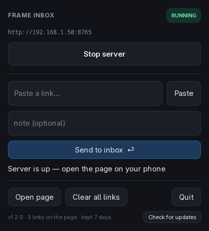

# Frame Inbox

Paste a link on your desktop, tap it on your phone. No QR codes, no phone apps, no accounts, no cloud.

A small HTTP page your phone bookmarks, a GTK panel that owns it, and a CLI for the times you don't want to open the panel. Built for a Steam Frame running SteamOS; works on any Linux desktop with GTK3.



## How it works

- **`server.py`** — a stdlib `http.server` on port 8765 serving a dark, thumb-sized list. `http(s)` rows open in the phone's browser; anything else with a scheme (`magnet:`, `mailto:`, `ss://`, `obsidian://`) renders as a **copy** row, because a phone browser cannot open those.
- **`control.py`** — a GTK3 panel that starts and stops that server, sends links, clears them and updates itself. The server is armed with a parent-death watchdog, so it cannot outlive the panel even if the panel is killed.
- **`sendlink`** — a CLI for sending without the panel.

Entries expire after 7 days, pruned whenever something is written.

## Requirements

- Linux with GTK3 Python bindings (`python3-gi`) and Python 3.9+
- Optional: `rsvg-convert` (icon rendering), `node` (smoke test only)

## Install

### On the headset

No Windows PC needed — the Frame is a PC, it just isn't a Windows one. Desktop Mode → Konsole → paste this line (the copy button appears on hover):

```bash
git clone https://github.com/variablefate/frame-inbox && cd frame-inbox && ./install.sh --desktop-icon
```

That puts the app in `~/.local/share/frame-inbox/`, the launchers in `~/.local/bin/`, and an icon on the desktop. Nothing goes system-wide, no root, and `git` ships with SteamOS.

### From a Windows PC with FrameDrop

[](https://framedropvr.com/install?manifest=https%3A%2F%2Fraw.githubusercontent.com%2Fvariablefate%2Fframe-inbox%2Fmain%2Fframedrop.json)

Only useful if you have a Windows PC — FrameDrop's client is Windows-only, and its install page has no fallback when opened in the headset's own browser.

**Why it lands in your Steam library:** that is the only thing FrameDrop knows how to do — it registers the app as a *Devkit Game* and adds a shortcut. It is a poor fit for a desktop utility: launched from the library it runs under Gaming Mode, where the panel's minimize-to-taskbar has nowhere to go. Treat it as the no-terminal way onto the machine, then use it from Desktop Mode. The one-liner above is the better path. If you do launch that shortcut from Gaming Mode, the first run installs the app where it belongs — app menu and Desktop — and says so, instead of opening a panel with no taskbar to minimise into.

The bundle's sha256 is `cd5e7a5ec92a52edcb8e7e345515e62cbc95cf0eea49be42f67404a5db7afab6`, also pinned in [`framedrop.json`](framedrop.json).

### Then, either way

1. Launch **Frame Inbox** (app menu or desktop icon).
2. On the phone, open `http://<your-lan-ip>:8765` and *Add to Home screen*.
3. Paste a link, hit **Send to inbox**, tap it on the phone.

Use the IP, not a `.local` name — Android Chrome does not resolve mDNS reliably.

**On the home screen:** the page ships a web app manifest, so the shortcut gets a real name and icon and iOS opens it without browser chrome. A true *Install app* prompt needs a secure origin, which `http://<lan-ip>:8765` is not — Chrome reports `not-from-secure-origin`. Front the port with HTTPS (e.g. `tailscale serve`) and the same manifest makes it an installable PWA, no code change.

## Updating

Click **Check for updates** in the panel: **Update to vX**, then **Restart to apply** — that stops the server and re-execs the panel on the new code.

From a terminal, or headless:

```bash
curl -fsSL https://raw.githubusercontent.com/variablefate/frame-inbox/main/update.sh | bash
```

It downloads the latest release, verifies the pinned sha256, and swaps only the app files — links, log and retention untouched. Add `-s -- --check` to see what it would do without changing anything. It finds the install itself, including a FrameDrop sideload; `--dir <path>` disambiguates.

## The panel

| Control | What it does |
|---|---|
| Start / Stop | Runs or stops the local server (it starts automatically when the panel opens) |
| Paste | Pulls the clipboard into the link field |
| Send to inbox | Adds the link and optional note; works even when the server is stopped |
| Clear all links | Two-step: first click arms it for 5 s, second wipes |
| × on a row | Deletes that link, with a 6 s undo |
| Open page | Opens the page in the local browser |
| Check for updates | See [Updating](#updating) |
| Quit | Stops the server, then exits |

Closing the window minimizes it to the taskbar while the page keeps serving. There is no tray icon — this image ships no AppIndicator bindings and a package install would not survive SteamOS atomic updates — so the taskbar entry is the equivalent.

## CLI

```bash
sendlink 'https://example.com/x' 'optional note'   # add (also prunes)
sendlink -                                         # read the url from stdin
sendlink                                           # list the newest 15
sendlink --push 'https://example.com/x'            # also send an ntfy notification
sendlink --topic                                   # generate/pick the ntfy topic
sendlink --prune                                   # apply retention now
sendlink --clear                                   # empty the inbox
```

`--push` uses [ntfy.sh](https://ntfy.sh): install the ntfy app, subscribe to the topic once, and tapping the notification opens the link. Useful when the phone is not on the same Wi-Fi.

## Configuration

| Variable | Default | Meaning |
|---|---|---|
| `SENDLINK_PORT` | `8765` | Port to serve on |
| `SENDLINK_KEEP_DAYS` | `7` | Retention window; `0` keeps forever |
| `FRAME_INBOX_HOME` | `$XDG_DATA_HOME/frame-inbox` | Where the store, log and pid live |
| `FRAME_INBOX_PATH` | `$FRAME_INBOX_HOME/inbox.jsonl` | Store location (tests) |
| `FRAME_INBOX_PIDFILE` | `$FRAME_INBOX_HOME/server.pid` | Pid file location (tests) |

## HTTP API

| Route | Behaviour |
|---|---|
| `GET /` | The page |
| `GET /raw` | Plain text, newest first |
| `GET /latest` | 302 to the newest entry, skipping copy rows |
| `GET /health` · `GET /version` | `ok` · the installed version |
| `GET /manifest.webmanifest` | Web app manifest |
| `POST /add` | Body: `url` or `url\nnote` |
| `POST /delete` · `POST /clear` | By entry id · wipes everything, returns the count |
| `POST /shutdown` | Answers, then exits |

## Security

No authentication by design: anything on your LAN can read and delete links, and traffic is unencrypted. Cross-origin writes and DNS-rebinding hosts are rejected, the page ships a strict CSP, and the store is `0600`. See [SECURITY.md](SECURITY.md) for what is and is not protected.

## Development

Plain Python, no build step. After an edit, restart the panel — it spawns a fresh server.

```bash
xvfb-run -a python3 scripts/panel-smoke-test.py
```

That drives the real GTK handlers headlessly, checks the page's inline JavaScript parses, exercises the security headers, and asserts the live inbox is untouched.

Three things that will bite you before they show:

- The page template is assembled with `.replace()` markers, never `str.format()` — every CSS/JS brace would otherwise need doubling.
- A backslash meant for JavaScript has to be written `\\n` in the Python source; a live newline silently kills the whole `<script>` block.
- Start/stop pollers carry a generation counter. Without it, a stop-poller left over from the previous stop kills the server you just restarted.

### Releasing

1. Bump `VERSION`.
2. `python3 packaging/build-release.py` — it prints the bundle's sha256.
3. Put that sha256 and the new tag into `framedrop.json`.
4. Commit, then `git tag vX.Y.Z && git push --tags` and `gh release create vX.Y.Z dist/frame-inbox-linux-arm64.zip`.

`update.sh` compares the installed `VERSION` against the latest release *tag*, so a release that forgets to bump it will never be offered as an update.

## Uninstall

```bash
curl -fsSL https://raw.githubusercontent.com/variablefate/frame-inbox/main/uninstall.sh | bash
```

It lists everything it will remove, then asks: the server, launchers, menu and desktop entries, icons, the ntfy topic, and a FrameDrop sideload in `~/devkit-game` with its Steam entry. `--dry-run` lists only; `--keep-data` keeps your links.

From the application menu: right-click **Frame Inbox → Remove Frame Inbox (app and links)…** (trash icon). It shows a dialog listing exactly what will go before doing anything.

**You will see a second, useless item there.** Plasma generates *Uninstall or manage add-ons* (the Discover icon) for every application; it resolves to a package lookup, and this app owns no package, so it does nothing at all. Ours is the one with the trash icon.

**The desktop icon is just a shortcut file.** Right-click → *Move to Trash* removes the launcher and leaves the app installed. Uninstall from the app menu, or with the one-liner above.

**There is no Discover page.** Discover only offers *Uninstall / Manage Add-ons* for things it installed itself — packages or Flatpaks. This app lives in your home directory with no package backend, so there is nothing for Discover to remove. The desktop action is the supported equivalent; a Flatpak build would be the only way to get the Discover entry.

Removing a Steam entry goes through the devkit tools, so Steam has to be running — if it isn't, the script says so and leaves that tile for you.

## License

MIT
